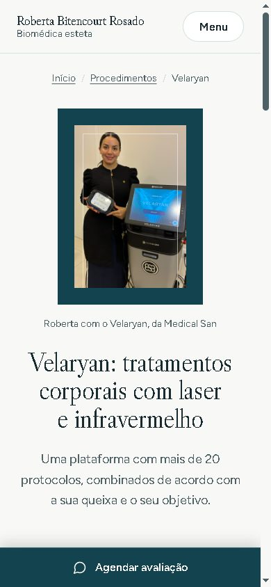
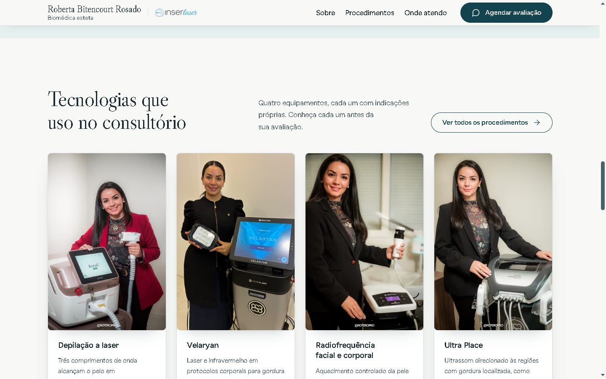
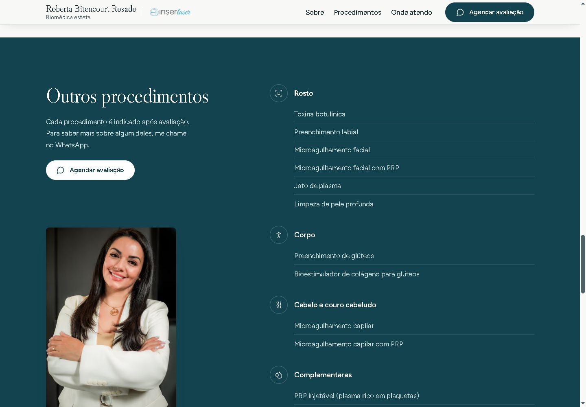

# Roberta Bitencourt Rosado | Site profissional de biomedicina estética

Site institucional de uma biomédica esteta em Santiago/RS, pensado para **ser encontrado** (Google, Bing e ferramentas de IA), **carregar rápido no celular** e **levar a pessoa ao agendamento pelo WhatsApp**.

**No ar:** [robertabitencourtesteta.com.br](https://robertabitencourtesteta.com.br)

> Este repositório apresenta o projeto: decisões, arquitetura e resultados. O código-fonte é privado.


---

## Sumário
- [Capturas](#capturas)
- [Resultados medidos](#resultados-medidos)
- [Tecnologias](#tecnologias)
- [Por que Astro](#por-que-astro)
- [Decisões de arquitetura](#decisões-de-arquitetura)
- [Estrutura do projeto](#estrutura-do-projeto)
- [Processo de desenvolvimento](#processo-de-desenvolvimento)
- [Hospedagem e publicação](#hospedagem-e-publicação)

---

## Capturas

| Celular: abertura | Celular: página de procedimento | Celular: perguntas frequentes |
|---|---|---|
|  |  |  |

**Tecnologias que ela usa no consultório:** cada card leva à página do procedimento.


**Os demais procedimentos**, organizados por região; cada item abre o WhatsApp com a mensagem já escrita.


**Página de procedimento:** o conteúdo começa logo abaixo do botão; a foto e a caixa de agendamento acompanham a leitura.


**Prévia ao compartilhar o link** (WhatsApp, Instagram, Facebook): cada página tem sua própria imagem 1200×630.
| Home | Página do Velaryan |
|---|---|
|  |  |

---

## Resultados medidos

Medido em produção, simulando um celular (390 px), com cache vazio:

| Página | Carregamento inicial | Requisições | JavaScript |
|---|---|---|---|
| Home | **140 KB** | 13 | **nenhum arquivo `.js`**; 1,3 KB de script embutido (menu e carrossel) |
| Página de procedimento | **89 KB** | 10 | **nenhum arquivo `.js`**; 0,8 KB de script embutido |

- **HTML da home:** cerca de 10 KB compactado.
- **Fotos:** os originais (110 a 250 KB cada) viram versões AVIF/WebP de 15 a 80 KB, no tamanho certo para cada tela, carregadas só quando aparecem.
- **Testes automatizados (Playwright):** 6 páginas × 4 larguras de tela (375, 768, 1280 e 1440 px), sem rolagem lateral, links ou imagens quebradas e sem erros no console.
- **Busca:** site verificado no Google Search Console e no Bing Webmaster Tools, com sitemap enviado e dados estruturados validados no teste de resultados avançados do Google.

---

## Tecnologias

| Camada | Escolha |
|---|---|
| Framework | **Astro 7**, saída 100% estática |
| Conteúdo | Coleções de conteúdo do Astro (Markdown + schema validado com Zod) |
| Estilo | CSS puro com tokens (variáveis CSS); sem framework de CSS |
| Imagens | `astro:assets` + sharp (AVIF/WebP responsivos) |
| Fontes | Libre Caslon (títulos) e Figtree (texto), **hospedadas no próprio site** |
| SEO | `@astrojs/sitemap`, dados estruturados schema.org, imagens Open Graph, `llms.txt` |
| Hospedagem | **Cloudflare Pages** (CDN global, HTTPS, deploy a cada push) |
| Qualidade | Playwright (testes em navegador), detector de design Impeccable |

Dependências do projeto: **5**. Nenhuma biblioteca de interface (React, Vue etc.) roda no navegador do visitante.

---

## Por que Astro

O site é de **conteúdo**: apresentação, procedimentos, fotos e um botão de WhatsApp. Não tem login, painel nem formulários. O que importa é ser encontrado, abrir rápido no 4G e ser fácil de manter. A comparação que guiou a escolha:

| Critério | **Astro** | React puro (SPA) | Next.js |
|---|---|---|---|
| Google e IAs | HTML pronto em cada página | conteúdo montado no navegador; pior para indexação | HTML pronto |
| JavaScript enviado | **zero por padrão** | biblioteca React (~45 KB+) antes do conteúdo | React + framework (~80–100 KB+) |
| Celular no 4G | o navegador só desenha HTML e CSS | tela em branco até o JS carregar | rápido, mas precisa "hidratar" a página |
| Otimização de imagens | integrada | configuração à parte | integrada, pensada para servidor |
| Hospedagem | arquivos estáticos, gratuita | estática | ideal com servidor/Vercel |

### A arquitetura de Islands (ilhas)

O Astro trata a página como **HTML estático** e só envia JavaScript para as "ilhas" que realmente precisam ser interativas, um componente por vez, e apenas quando necessário. O resto da página nunca carrega framework nenhum.

**Neste site, nenhuma ilha foi necessária.** As duas interações (abrir o menu no celular e os pontos do carrossel de tecnologias) são resolvidas com pouco mais de 1 KB de script, e as perguntas frequentes usam o elemento nativo `<details>` do HTML. Por isso o carregamento da home não tem nenhum arquivo JavaScript.

A arquitetura continua sendo uma vantagem: se o projeto ganhar, por exemplo, **agendamento online com calendário**, ele pode entrar como uma ilha React nessa única seção, e o restante do site continua leve. Não é preciso trocar de framework para crescer.

---

## Decisões de arquitetura

### 1. Uma página por procedimento
Quem procura no Google não procura por "biomédica esteta". Procura pelo **problema ou pelo procedimento**: "depilação a laser em Santiago", "tratamento para gordura localizada", "radiofrequência para flacidez". Cada tecnologia tem uma página própria, com título, descrição, imagem de compartilhamento e dados estruturados específicos. Assim, **cada busca específica tem uma página feita para ela**, e a profissional aparece como resposta.

- As páginas são geradas de **um único modelo**. Para criar a página de um novo procedimento, basta preencher o arquivo de conteúdo dele e ligar uma opção; o link na home e a entrada no sitemap aparecem sozinhos.
- Os procedimentos que ainda não têm página aparecem na home por categoria, com link direto para o WhatsApp. **Não existe link quebrado por construção:** a home só cria o link quando a página existe.

### 2. Conteúdo em perguntas e respostas diretas
Ferramentas de IA (ChatGPT, Perplexity, as respostas geradas pelo Google) montam respostas **copiando trechos curtos** de páginas que respondem de forma direta. O conteúdo foi estruturado para isso:

- **Títulos das seções são perguntas reais** ("O que é a depilação a laser?", "Como funciona o Ácrus?", "O Velaryan trata lipedema?").
- **A primeira frase de cada resposta responde sozinha**, citando o procedimento, a profissional e a cidade. Copiada isoladamente, continua correta e identifica a fonte.
- **Perguntas frequentes** na home e em cada página, incluindo buscas locais como "Onde fazer Velaryan em Santiago/RS?".
- **Terceira pessoa nas perguntas frequentes**, de propósito: "Roberta Bitencourt Rosado é biomédica esteta…" continua fazendo sentido fora do site; "Sou biomédica esteta…" perde quem fala. O restante do site mantém a voz da profissional em primeira pessoa.
- Os dados estruturados `FAQPage` são **gerados das mesmas perguntas visíveis**, então a marcação nunca diverge do texto.
- **`/llms.txt`:** resumo do site em texto simples para IAs, gerado no build a partir dos mesmos dados.

### 3. SEO técnico
- **Dados estruturados (schema.org):** negócio local de saúde e beleza (endereço, CEP, telefone, Instagram, área atendida), a profissional (com registro no conselho), cada serviço, trilha de navegação e perguntas frequentes.
- **Sitemap automático**, `robots.txt`, endereço canônico em cada página e redirecionamento do `www` para o domínio principal.
- **Imagem de compartilhamento por página** (1200×630), com a foto inteira, sem corte.
- **Proteção de lançamento:** sem o domínio configurado, o build marca todas as páginas como `noindex`, para que o endereço provisório da hospedagem não seja indexado. A página 404 é sempre `noindex`.

### 4. Conteúdo como dado, com fonte única
- Nome, registro profissional, WhatsApp e endereço ficam em **um único arquivo**. O número de WhatsApp aparece em dezenas de botões e respostas, mas muda numa linha.
- Cada procedimento é um arquivo Markdown validado por schema. Um campo obrigatório faltando **impede o build**, em vez de publicar uma página incompleta.
- Uma estrutura para **galeria de antes e depois** já existe, desligada, e o schema exige consentimento assinado e revisão para cada imagem.

### 5. Política de imagens verificada no build
- As fotos de um procedimento **nunca podem aparecer na página de outro**. Isso é checado automaticamente: se alguém apontar a foto errada, **o build falha** com uma mensagem explicando o motivo.
- As fotos aparecem **inteiras (proporção 2:3)**, preservando as marcas d'água dos fotógrafos. Os originais nunca são alterados; o site usa versões otimizadas geradas no build.

### 6. Pensado primeiro para o celular
- Barra fixa de **"Agendar avaliação"** no rodapé da tela, que abre o WhatsApp com a mensagem pronta (e menciona o procedimento quando a pessoa está numa página específica).
- No celular, a foto vem antes do título e os botões ocupam a largura da tela; os quatro equipamentos viram um carrossel com pontos indicadores.
- Mensagens pré-preenchidas por procedimento, para a recepção saber do que se trata antes de responder.

### 7. Acessibilidade e privacidade
- HTML semântico, navegação por teclado, atalho "pular para o conteúdo", foco visível, contraste conferido (AA), textos alternativos descritivos e respeito a "reduzir movimento".
- **Sem rastreadores e sem formulários:** nenhum dado pessoal é coletado pelo site. As fontes são servidas pelo próprio domínio, sem chamadas a serviços de terceiros.

---

## Estrutura do projeto

```
├── geral/                     Fotos e textos originais da profissional (nunca alterados)
├── procedimentos/             Uma pasta por tecnologia: foto com o equipamento + texto original
├── docs/                      Planejamento, textos aprovados, perguntas e respostas, questionário
├── scripts/og/                Gerador das imagens de compartilhamento (1200×630)
├── public/                    Arquivos servidos como estão (favicon, redirecionamentos)
└── src/
    ├── content/procedimentos/ Um arquivo por procedimento: textos, perguntas, SEO, status de validação
    ├── content.config.ts      Schema que valida o conteúdo (campos obrigatórios, antes/depois)
    ├── data/                  Dados únicos: profissional, contato, endereço, categorias
    ├── lib/                   Regras compartilhadas: fotos (e a trava de política), WhatsApp,
    │                          imagens de compartilhamento, dados estruturados, indexação
    ├── components/            Seções e peças reutilizáveis (cabeçalho, abertura, cards,
    │                          perguntas frequentes, fechamento, logo…)
    ├── layouts/               Estrutura comum das páginas (metadados, SEO, cabeçalho, rodapé)
    ├── pages/                 Home, modelo único das páginas de procedimento, 404,
    │                          robots.txt e llms.txt (gerados)
    ├── assets/                Imagens de compartilhamento e a logo tratada
    └── styles/                Tokens de design (cores, tipografia, espaços) e estilos globais
```

---

## Processo de desenvolvimento

O projeto foi feito em fases, com aprovação a cada etapa:

1. **Diagnóstico:** inventário de arquivos e fotos, levantamento de divergências (grafia do nome, do equipamento, do registro) e de alegações que precisavam de validação profissional.
2. **Pesquisa visual:** análise de sites de referência do mesmo nicho (SkillUI e medições no navegador) e recomendações de design para estética e saúde (UI/UX Pro Max), com três direções visuais propostas.
3. **Conteúdo:** textos reescritos a partir dos originais, sem promessas de resultado e sem informações inventadas; todas as alegações clínicas foram **validadas pela profissional** antes da publicação.
4. **Implementação:** componentes reutilizáveis e um único modelo para as páginas de procedimento.
5. **Refino e testes:** crítica de design com Impeccable (hierarquia, tipografia, espaçamento, estados interativos e celular) e testes em navegador com Playwright em várias larguras.
6. **Publicação e busca:** domínio próprio, Cloudflare Pages, Search Console, Bing Webmaster Tools, dados estruturados e conteúdo em perguntas e respostas.

---

## Hospedagem e publicação

- **Cloudflare Pages**, conectado ao repositório privado: **cada push publica o site** em 1 a 2 minutos.
- O domínio é gerenciado pela Cloudflare (DNS, HTTPS automático, redirecionamento do `www`).
- **Crawler Hints** ativado: o Bing é avisado automaticamente sempre que o site muda.

---

<sub>Fotos e marca usadas com autorização. Código-fonte privado.</sub>
